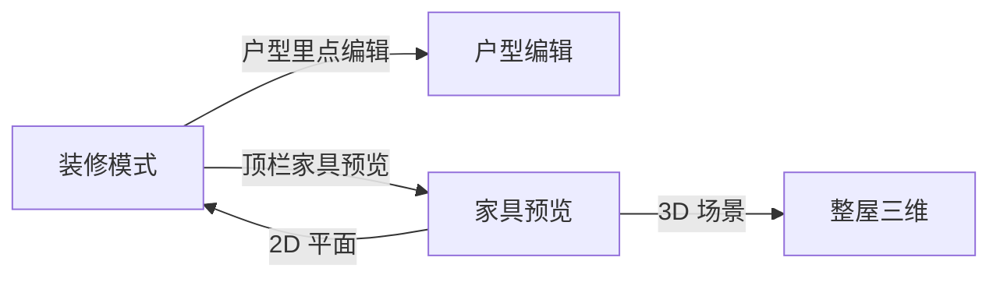

# 装修、改墙、家具预览分开

只改 [floorplan-3d/index.html](floorplan-3d/index.html)。三种用法共用现在的顶栏、左侧家具库和右侧属性，中间画布按模式换内容。

## 装修模式去掉拆改

图 1 的「拆改墙体」从顶栏拿掉，快捷键 `X` 和右侧说明里的拆改条目一起去掉。不把这个工具放进户型编辑：编辑里本来就可以直接删墙。已经标过拆除的墙仍按虚线画出来，数据不改。

## 户型编辑不显示家具

进入 `enterEditor()`（`body.editing`）后，中间只保留改户型需要的东西：房间地面、房间名、尺寸线、墙、门、窗、飘窗。

藏起来的是家具本身和只服务于家具的控件：

- `#gFurn` 和家具选中框
- 家具库（现在就会收起）
- 「家具」「贴墙吸附」图层按钮、「清空布置」
- 若进来之前选中的是家具，清空选择

墙、门、窗、推拉门、飘窗的添加工具保持现状。选中之后按下面一节改位置和长短。

## 门窗和飘窗可以拖、可以改属性

户型编辑里，选中门、窗、推拉门或飘窗后，沿所在墙画出两个端点，拖法与现在的墙端点一样。拖某一端只沿这面墙移动，同时改起点 `t` 和长度 `len`：往外拉变长，往里推变短，整段也会跟着挪。吸附 10 mm，最短约 300 mm，不能伸出墙外，也不能压住旁边的门窗。松手记入撤销。

飘窗现在点进去只能删除。选中飘窗的地面、侧墙或窗，都当成同一件飘窗，改的是记录 `{wallId, t, len, depth}`，再由现有的 `refreshBays()` 重算侧墙和玻璃。右侧属性给出宽度、进深、沿墙起点，改数字和拖动写的是同一组字段。

图里这块飘窗另外可以拖外沿：拖外侧那条边，沿垂直于主墙的方向改 `depth`。生成出来的侧墙不再单独拖端点，避免和飘窗记录对不上。

## 家具预览：中间只放选中的那一件

顶栏在「2D 平面 / 3D 场景」旁边加「家具预览」，三者互斥。编辑墙体时先提示保存或取消，不进入预览。

中间复用已有的 three.js 画布和 `buildFurniture`（约 2919 行，模型已经按类型搭好）。预览时：

- 关掉整屋的地面房间、墙体、房间名和其它家具
- 把当前选中的那一件放到原点，镜头对着它，可以旋转查看
- 右侧改宽、深、颜色、旋转后，立刻重画这一件
- 左侧点一件家具：仍加入当前户型并选中，预览跟着换成新的这件
- 没有选中时，中间是空地面，并提示先从左侧点一件

预览时藏起只对平面图或整屋有用的按钮（测量、比例、尺寸图层、漫游、日照）。退出预览回到 2D 平面，或切到原来的整屋 3D。
